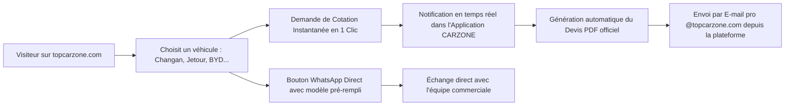

# NOTE STRATÉGIQUE & AUDIT DIGITAL : CARZONE SARL
**Document exécutif préparé à l'attention de la Direction Générale**  
**Date :** 21 Octobre 2026  
**Auteur :** Igor GIANI, Ingénieur Systèmes d'Information & Solutions Digitales  

---

## 1. CONSTAT & DIAGNOSTIC DU SITE ACTUEL (`topcarzone.com`)

L'audit technique et commercial mené sur le site web existant met en évidence plusieurs freins majeurs à la vente :

| Limite constatée sur l'ancien site | Conséquence commerciale directe |
|---|---|
| **Fiches véhicules statiques non cliquables** | Le visiteur ne peut pas explorer en détail le véhicule qui l'intéresse ni voir ses options. |
| **Aucune demande de cotation immédiate** | Le prospect est forcé de quitter la page du véhicule pour aller sur un formulaire générique *"Contact"*. **70% des acheteurs abandonnent à ce stade.** |
| **Saisie manuelle fastidieuse** | Le client doit réécrire lui-même le modèle qui l'intéresse, son e-mail et son message. Risque d'erreur et perte de temps. |
| **Absence de passerelle WhatsApp** | Au Bénin, plus de 80% des décisions d'achat automobile s'accélèrent sur WhatsApp. Le site actuel ne propose aucun contact instantané par véhicule. |
| **Boîtes e-mails isolées** | Les demandes formulées en ligne arrivent sur des boîtes séparées, sans suivi commercial partagé ni tableau de bord pour la Direction. |

---

## 2. LA NOUVELLE SOLUTION : PLATEFORME COMMERCIALE UNIFIÉE

La nouvelle infrastructure transforme le site web en un **moteur actif de génération de chiffre d'affaires** :

### Les 4 Piliers de la Nouvelle Plateforme :
1. **Conversion en 1 clic :** Chaque véhicule possède son bouton de cotation directe. Le modèle, la motorisation et la finition sont automatiquement enregistrés.
2. **Intégration WhatsApp Business :** Un simple clic ouvre une conversation pré-remplie : *"Bonjour Carzone, je souhaite avoir le prix et la disponibilité du modèle Changan CS55 Plus..."*.
3. **E-mails d'entreprise intégrés :** Les commerciaux rédigent, envoient et reçoivent les offres directement dans l'outil, sous les adresses officielles `@topcarzone.com`.
4. **Visibilité totale pour le DG & la Directrice :** Un tableau de bord affiche en temps réel le nombre de prospects, les véhicules les plus demandés, et l'état des relances.

---

## 3. TABLEAU COMPARATIF : ANCIEN VS NOUVEAU SYSTÈME

| Fonctionnalité | Ancien site (`topcarzone.com`) | Nouvelle Plateforme Développée |
|---|---|---|
| **Navigation par véhicule** | Statique (images simples) | Interactive avec fiches techniques détaillées |
| **Demande de devis** | Formulaire contact classique | Générateur de cotation instantanée |
| **WhatsApp Direct par véhicule** | ❌ Non | ✅ Oui, message pré-personnalisé |
| **Suivi des prospects (CRM)** | ❌ Aucun (éparpillé sur boîtes mails) | ✅ Centralisé avec alertes et relances |
| **Facturation & e-MECeF** | ❌ Déconnecté | ✅ Prêt pour liaison avec la facturation normalisée |
| **Gestion du stock (Showroom)** | ❌ Aucun lien | ✅ Connexion directe au stock disponible |

---

## 4. PLAN DE DÉPLOIEMENT SANS COUPURE DE SERVICE

Pour rassurer la Direction sur la continuité de l'activité commerciale :

* **Phase A (Invisible pour le public) :** Récupération des accès techniques et configuration de la nouvelle infrastructure sur un serveur sécurisé de pré-production.
* **Phase B (Validation Direction) :** Présentation privée à la Direction et aux commerciaux pour validation des fiches et des tarifs.
* **Phase C (Bascule en 5 minutes) :** Pointage du nom de domaine `topcarzone.com` vers la nouvelle plateforme. **Zéro coupure, zéro perte d'e-mails.**
